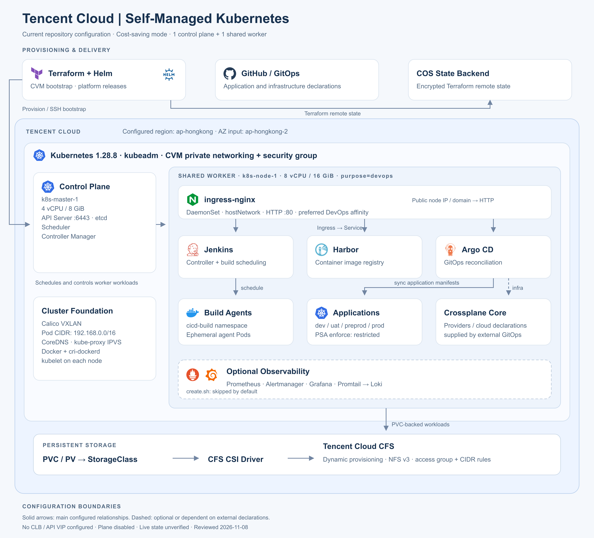
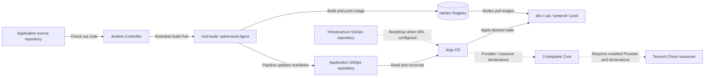

# Tencent Cloud Self-Managed Kubernetes Architecture

Based on this repository's Terraform, bootstrap scripts and Helm values. Reviewed on 2026-11-08. This describes repository configuration; live cloud and cluster state have not been verified.

[Scalable SVG](assets/architecture.svg) · [PNG image](assets/architecture.png)

## Current configuration

- **Foundation:** Tencent Cloud CVM, Kubernetes 1.28.8, kubeadm, Docker and cri-dockerd. Cost-saving mode retains one control plane (`k8s-master-1`, 4 vCPU / 8 GiB) and one shared DevOps worker (`k8s-node-1`, 8 vCPU / 16 GiB).
- **Networking:** Calico VXLAN, Pod CIDR `192.168.0.0/16`, CoreDNS and kube-proxy IPVS. Each CVM receives a public IP. ingress-nginx uses a DaemonSet, hostNetwork and a ClusterIP Service; it prefers DevOps nodes through soft affinity.
- **Delivery:** Jenkins, Harbor, Argo CD and Crossplane Core are enabled in the component inventory. Plane is disabled. Jenkins schedules ephemeral build Pods in `cicd-build`.
- **Applications:** Terraform creates `dev`, `uat`, `preprod` and `prod` namespaces with Restricted PSA enforcement. Business deployments and promotion policy depend on external GitOps declarations.
- **Storage:** PVCs use a StorageClass backed by the CFS CSI driver. CFS is dynamically provisioned, with NFS v3 mounts, an access group and CIDR rules. The StorageClass reclaim policy is `Delete`.
- **Observability:** Prometheus, Alertmanager, Grafana, Loki and Promtail are configured. `modules/script/create.sh` defaults to `DEPLOY_MONITORING=false`; a regular full Terraform deployment still includes the monitoring module.
- **State:** Terraform uses an encrypted COS remote-state backend.

Solid arrows show the principal configured relationships. Dashed arrows or borders identify optional components or dependencies on external declarations. The overview groups components by responsibility and does not depict every runtime connection.

## CI/CD and GitOps flow

This repository implements the Jenkins build environment, Harbor credential integration, node registry access, application image-pull credentials and Argo CD bootstrap. Application pipelines, deployment manifests, promotion policies and Crossplane Provider/resource declarations depend on external repositories. Their end-to-end operation is not established by this repository alone. Argo CD reads deployment declarations from Git; Harbor serves container images.

## Configuration boundaries

1. `modules/dev.tfvars` enables `k8s_cost_saving_mode=true`. Disabling it uses the configured three Masters and three Workers: node1/node2 are tagged for DevOps and node3 for applications. Platform and application workloads share the Worker in the current mode.
2. The control-plane endpoint is the first Master's private IP. No CLB, VIP or highly available API endpoint is configured, so the full node inventory alone does not establish a fully highly available cluster.
3. `vpc_id` and `subnet_id` are inputs used by the CFS StorageClass. The CVM resource does not explicitly set these fields. The diagram therefore does not assert that CVMs and CFS use the same specified VPC/subnet. CVM availability zone selection also uses a data source; the region/AZ labels describe configured inputs.
4. Platform Ingress values configure HTTP without TLS termination. DevOps affinity is a preference, not exclusive placement on dedicated nodes.
5. Terraform directly manages the CFS access group, rules and StorageClass; the CSI driver dynamically provisions file systems in response to PVCs.
6. Application namespaces enforce Restricted PSA. Monitoring and CI/CD namespaces mainly configure audit/warn, so Restricted enforcement does not apply uniformly to the whole cluster.
7. Crossplane Core installation does not install Providers or create managed cloud resources. External infrastructure GitOps must supply those declarations and satisfy readiness prerequisites.
8. The README describes an etcd-to-COS backup approach, but no corresponding automated backup/restore implementation was found in the inspected source. COS is shown only as the Terraform state backend.

## Source references

| Area | Source |
| --- | --- |
| Region, node inventory, component switches | `modules/dev.tfvars` (non-sensitive configuration only) |
| CVMs, node filtering, public IPs, security group | `modules/k8s_cvm/main.tf` |
| kubeadm, Calico, IPVS, runtime and CSI bootstrap | `modules/k8s_cvm/script/init.sh.tpl` |
| Ingress network mode and scheduling | `modules/k8s_ingress/helm_values/ingress-nginx.yaml` |
| CFS and dynamic storage configuration | `modules/k8s_cfs/main.tf` |
| Platform components and build namespace | `modules/k8s_cicd/main.tf`, `modules/k8s_cicd/helm_values/` |
| GitOps bootstrap and Crossplane boundaries | `modules/k8s_cicd/argocd_bootstrap.tf`, `modules/k8s_cicd/CROSSPLANE.md` |
| Application namespaces and PSA | `modules/k8s_app/main.tf` |
| Observability and script defaults | `modules/k8s_monitoring/`, `modules/script/create.sh` |
| COS remote state | `modules/main.tf` |

## Artwork and regeneration

Brand icons are vendored from [Simple Icons v15.20.0](https://www.npmjs.com/package/simple-icons/v/15.20.0). See [icon license](assets/icons/LICENSE.md). Icons identify their respective projects; the illustration does not imply endorsement. Components without a matching bundled brand icon use text labels.

Regenerate the self-contained SVG using `python3 docs/assets/render-architecture.py`. The PNG is a 2× raster export of that SVG.

Only documentation and artwork are changed. No infrastructure configuration, credentials or deployed resources are modified.
